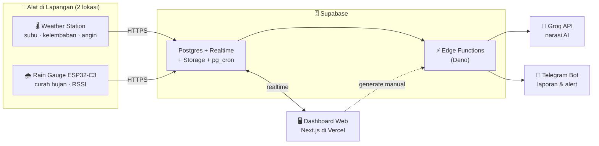

<div align="center">

# 🌦️ AWS T4T — AtmosX
### Dokumentasi Sistem Lengkap: Software, Hardware & Arsitektur

  

*Disusun langsung dari kode yang berjalan di produksi — bukan dari rencana awal yang sudah usang.*

</div>

---

### 📑 Daftar Isi

1. [Ringkasan Satu Halaman](#1-️-ringkasan-satu-halaman)
2. [Arsitektur Sistem](#2--arsitektur-sistem)
3. [Hardware](#3--hardware)
4. [Software](#4--software)
5. [Deployment & Akun](#5--deployment--akun)
6. [Riwayat Bug & Perbaikan](#6--riwayat-bug--perbaikan-war-stories)
7. [Referensi Silang Dokumen](#7--referensi-silang-dokumen)

> 💡 **Catatan penting:** beberapa angka di PRD/README lama (mis. ambang offline 90 menit, lokasi penyimpanan RSSI) sudah **berubah** di kode aktual. Dokumen ini mengikuti kode yang hidup sekarang, bukan rencana lama — perbedaannya ditandai jelas di setiap bagian yang relevan.

---

## 1. ☁️ Ringkasan Satu Halaman

**AWS T4T (AtmosX)** adalah sistem **monitoring mikroklimat pertanian real-time** yang menyatukan alat IoT di lapangan, database cloud, dashboard web, AI, dan notifikasi Telegram — dalam satu alur otomatis tanpa campur tangan manual.



**3 prinsip utama yang membentuk seluruh sistem:**

| 🔒 Read-only & non-destructive | 🔀 2 alat, 2 status per lokasi | ⏱️ Kuirk waktu WIB |
|---|---|---|
| Dashboard & fitur baru **tidak pernah** mengubah skema tabel lama (`devices`, `sensors`) atau mengganggu firmware produksi. Semua tambahan bersifat aditif. | Weather station (→ `sensors`) dan rain gauge (→ `rainfall_readings`) adalah **dua ESP32 fisik berbeda** dengan status online/offline masing-masing. | `created_at` berlabel UTC tapi angkanya **sudah WIB** — sengaja dibiarkan di sumbernya, dikompensasi di kode web. |

---

## 2. 🏗️ Arsitektur Sistem

### 2.1 Komponen Utama

| # | Komponen | Peran |
|---|---|---|
| 1️⃣ | **ESP32 Weather Station** (per lokasi) | Baca suhu, kelembaban, kecepatan & arah angin → tabel `sensors` |
| 2️⃣ | **ESP32-C3 Rain Gauge** (per lokasi) | Baca curah hujan tipping-bucket (I2C) + RSSI WiFi → tabel `rainfall_readings` |
| 3️⃣ | **Supabase Postgres** | Database utama + RLS + Realtime (WAL change feed) + Storage (chart cache, firmware `.bin`) |
| 4️⃣ | **Supabase Edge Functions** (Deno) | Logic server-side terjadwal: laporan mingguan, rekomendasi AI, alert real-time, backup monitor, webhook Telegram |
| 5️⃣ | **pg_cron** | Memicu Edge Function sesuai jadwal lewat HTTP call (`pg_net`) |
| 6️⃣ | **Next.js Dashboard** (Vercel) | UI web: realtime card, analitik, kiosk mode, download data, admin OTA |
| 7️⃣ | **Groq API** | Menulis **narasi** rekomendasi dari angka yang sudah dihitung rule engine — tidak pernah menghitung sendiri |
| 8️⃣ | **Telegram Bot API** | Push laporan mingguan, alert kritis, dan command chat (`/laporan`) |

### 2.2 Alur Data — Langkah demi Langkah

```
①  ESP32 lapangan ──HTTPS──► Supabase REST (insert langsung, anon key + RLS)
②  Dashboard ◄──Realtime (postgres_changes)── Supabase  (update tanpa reload)
③  Supabase SQL view/function menghitung agregasi berat (akumulasi hujan, uptime, kuota)
④  pg_cron ──HTTP (pg_net)──► Edge Function  (terjadwal: laporan, AI, snapshot BMKG, dll.)
⑤  Edge Function `generate-recommendation` → rule engine (VPD + risiko) → Groq (narasi saja)
⑥  Hasil → Telegram Bot API (parse_mode HTML, semua teks dinamis di-escape dulu)
⑦  `telegram-webhook` menerima command masuk (mis. /laporan) → balas on-demand
⑧  Admin upload firmware .bin → Supabase Storage → ESP32 cek versi tiap 2 menit → OTA
```

### 2.3 Prinsip Desain

- 🔐 **Read-only terhadap data lama** — tidak ada INSERT/UPDATE/DELETE dashboard ke `devices`/`sensors`.
- 🧩 **Tanpa foreign key ke tabel lama** — `rainfall_readings.device_id` sengaja lepas dari constraint, supaya skema lama tak perlu disentuh.
- ⚙️ **Agregasi berat di database**, bukan di client — hemat bandwidth, konsisten, skalabel.
- 🛡️ **Gagal dengan lembut** — contoh: kalau view hujan belum ada, dashboard tetap tampil "belum ada data" alih-alih crash.

---

## 3. 🔧 Hardware

### 3.1 Dua Alat per Lokasi

Tiap lokasi (**Cisangkuy** & **Ciminyak**) punya dua ESP32 fisik yang berdiri sendiri:

<table>
<tr><td width="50%" valign="top">

#### 🌡️ A. Weather Station
- Mengukur suhu (°C), kelembaban (%), kecepatan angin (m/s), arah angin (kompas 8 arah / *calm*)
- Upload ke tabel `sensors`
- **Kini kirim tiap 1 menit** (bukan 1 jam seperti asumsi PRD awal — lihat `lib/config.ts`)

</td><td width="50%" valign="top">

#### 🌧️ B. Rain Gauge — ESP32-C3 "SuperMini"
- Sensor **DFRobot SEN0575** (tipping-bucket, mode **I2C**)
- 1 guling mangkuk = **0,2794 mm** hujan (`MM_PER_TIP`, bisa dikalibrasi)
- Upload ke tabel `rainfall_readings`, tiap 1 menit + RSSI

</td></tr>
</table>

### 3.2 Spesifikasi Teknis Rain Gauge (Detail)

| Aspek | Detail |
|---|---|
| **Board** | ESP32-C3 "SuperMini" — kecil, murah, WiFi built-in |
| **Sensor** | DFRobot SEN0575, via I2C (`DFRobot_RainfallSensor_I2C`) |
| **Pin I2C** | SDA = GPIO 1 · SCL = GPIO 0 |
| **Prinsip baca** | Sensor melaporkan **counter kumulatif** (bukan nilai sesaat) → firmware hitung delta tiap siklus. Sampling lebih lambat ≠ kehilangan presisi. |
| **Siklus sampling** | 10 detik × 6 kali = 1 menit per upload (hemat I2C/Serial 5× dibanding versi lama) |
| **WiFi TX power** | ⚠️ **Semua board di kedua lokasi gagal connect di daya tinggi** (terdeteksi tapi tak pernah berhasil `WiFi.begin()`). Firmware langsung pakai daya rendah (`WIFI_POWER_8_5dBm`), tanpa percobaan daya tinggi sama sekali. |
| **Retry & self-healing** | Retry WiFi tiap 60 detik · restart otomatis jika WiFi putus >10 menit |
| **Watchdog** | Hardware WDT 60 detik + restart otomatis jika free heap <50KB atau blok memori terbesar <45KB |
| **OTA** | Cek firmware baru tiap 2 menit dari Supabase Storage, auto-download & flash |
| **Serial jarak jauh** | Saat diaktifkan dari dashboard, log dikirim ke tabel `device_console` tiap 3 detik (auto-mati sesuai batas waktu) |
| **Timezone** | GMT+7 (WIB) hardcoded, sinkron NTP setelah WiFi tersambung |

**Payload upload** (tiap 1 menit, langsung ke Supabase REST):
```json
{"device_id": 2, "rain_mm": 0.0000, "rainfall": 0.00, "rssi": -67}
```
| Field | Arti |
|---|---|
| `rain_mm` | Hujan (mm) sejak upload sukses sebelumnya — dasar akumulasi rolling 1/3/6/12/24 jam |
| `rainfall` | Akumulasi hujan **hari ini**, reset otomatis 00:00 WIB |
| `rssi` | Kekuatan sinyal WiFi (dBm) saat upload — ditambahkan di firmware v13 |

> Kedua firmware (`Firmware Rainfall Cisangkuy.ino` / `...Ciminyak.ino`) identik kecuali `DEVICE_ID` dan kredensial WiFi lokasi masing-masing.

### 3.3 Lokasi Fisik

| 📍 Lokasi | Koordinat | `device_id` |
|---|---|---|
| **Cisangkuy** (Cirasea) | -7.049497, 107.561626 | 1 |
| **Ciminyak** | -6.919351, 107.370483 | 2 |

### 3.4 Catatan Historis

Kolom `sensors.rainfall` adalah **peninggalan** desain lama (rencana awal: hujan ikut dikirim dari weather station). Sekarang selalu kosong/0 dan **tidak dipakai** — dibiarkan ada agar firmware weather station lama tidak terganggu. Data hujan resmi 100% dari `rainfall_readings`.

---

## 4. 💻 Software

### 4.1 Tech Stack

| Layer | Teknologi |
|---|---|
| Framework | **Next.js 14.2.15** (App Router) |
| Bahasa | **TypeScript 5.5.3** |
| UI | **React 18.3.1** + **Tailwind CSS 3.4.4** |
| Grafik | `recharts` 2.12.7 |
| Peta | `leaflet` 1.9.4 |
| Ikon | `lucide-react` |
| Export Excel | `exceljs` 4.4.0 |
| Backend | **Supabase** (Postgres, Realtime, Storage, Edge Functions/Deno, pg_cron) |
| AI | **Groq API** (narasi, bukan kalkulasi) |
| Notifikasi | **Telegram Bot API** |
| Hosting | **Vercel** |

### 4.2 Peta Halaman (Routes)

| Route | Fungsi |
|---|---|
| `/` | 🏠 Dashboard utama — kartu realtime, status online/offline, uptime, peta |
| `/kiosk` | 📺 Mode kiosk satu-layar-penuh untuk TV/monitor tanpa penjaga |
| `/analytics` | 📈 Tren suhu/kelembaban/angin + **grafik curah hujan terpisah** (per jam/hari, akumulasi, harian & rata-rata) |
| `/recommendations` | 🤖 Rekomendasi AI (VPD, risiko, narasi Groq) |
| `/reports` | 📨 Riwayat & generate manual laporan mingguan Telegram |
| `/download` | ⬇️ Laporan Excel, **CSV khusus curah hujan** (per hari / per jam / mentah), CSV cuaca mentah |
| `/bmkg` | 🛰️ Perbandingan dengan data resmi BMKG |
| `/kuota` | 📊 Monitoring kuota pemakaian |
| `/backups` | 💾 Status backup otomatis |
| `/rainfall-monitor` | 🌧️ Monitor detail sensor hujan |
| `/admin/firmware` | 🛠️ Upload firmware `.bin` untuk OTA |

### 4.3 Edge Functions (Deno)

| Function | Peran | Trigger |
|---|---|---|
| `weekly-report` | Generate + kirim laporan mingguan (chart + statistik + rekomendasi AI) | pg_cron |
| `generate-recommendation` | Rule engine → Groq → simpan ke `ai_recommendations` | pg_cron |
| `realtime-alert-check` | Cek kondisi kritis, kirim alert instan | Database Webhook (event-driven) |
| `backup-monitor` | Cek status backup → `backup_logs` | pg_cron |
| `telegram-webhook` | Balas command Telegram (`/laporan`, dll.) | Webhook HTTP |

> ⚠️ **Jebakan duplikasi:** logic laporan mingguan ada di **dua tempat** yang harus tetap sinkron — `supabase/functions/weekly-report/index.ts` (Deno, otomatis) dan `lib/weeklyReport.ts` (Next.js, tombol manual). Keduanya **wajib** pakai `escapeHtml()` sebelum menyisipkan teks AI ke pesan Telegram HTML.
>
> ⚠️ **Deno ≠ Node** — Edge Function tidak bisa `import { supabase } from "./supabase"` (gaya Next.js); harus pakai URL eksplisit `https://esm.sh/...`. Jangan salah tempel `lib/weeklyReport.ts` ke editor Edge Function Supabase.

### 4.4 Rule Engine — Otak Deterministik di Balik AI

📍 `lib/rules/ruleEngine.ts` — **semua angka pertanian dihitung dengan rumus/ambang tetap di kode** sebelum diserahkan ke Groq untuk dinarasikan. Groq **tidak pernah** menghitung ulang angka sendiri.

| Metrik | Rumus / Ambang |
|---|---|
| **VPD** (Vapor Pressure Deficit) | Rumus Magnus dari suhu & kelembaban → rendah (<0,8 kPa) / sedang (0,8–1,5) / tinggi (>1,5) |
| **Level risiko** | 🔴 Kritis: suhu >33°C **dan** kelembaban <55% · 🟡 Waspada: suhu >32°C **atau** kelembaban <60% · angin kuat (>8 m/s) + suhu >30°C menaikkan level satu tingkat |

### 4.5 Skema Database Aktual

**Tabel lama** (read-only, skema tidak pernah disentuh):
```
devices       (id, type)                     -- nama lokasi
sensors       (id, device_id, temperature, humidity, wind_speed,
               wind_direction, rainfall [DEPRECATED], created_at)
system_logs   (log lama)
```

**Tabel/view baru** (aditif, tanpa FK ke tabel lama):
```sql
rainfall_readings   (id, device_id, rain_mm, rainfall, rssi, created_at)
 ├─ view  rainfall_summary   → last_reading_at, rain_last_mm, rssi_last,
 │                              acc_1h/3h/6h/12h/24h, acc_today
 ├─ view  rainfall_hourly / rainfall_daily   → agregasi grafik
 └─ fn    rainfall_total() / rainfall_buckets()

ai_recommendations  (device_id, recommendation_text, generated_at, ...)
weekly_reports      (trigger_type, period_start/end, interval_days_config,
                      telegram_message_id, status, summary_text, error_message)
backup_logs
settings            (key-value config, mis. weekly_report_interval_days)

fn device_uptime(kind, device_id, start, end, threshold_minutes)
   → window_seconds, down_seconds, outage_count, longest_outage_seconds, recent_outages

device_quota / quota_cron            → kuota pemakaian
bmkg_adm4_defaults / bmkg_snapshots / bmkg_releases  → pembanding BMKG
```

Semua tabel baru: RLS `anon` boleh `insert` (alat) + `select` (dashboard), **tidak ada** `update`/`delete` publik.

### 4.6 ⏱️ Kuirk Waktu `created_at` (Penting!)

`sensors.created_at` & `rainfall_readings.created_at` **berlabel UTC (`+00`)**, tapi **angka jamnya sebenarnya WIB** — firmware menulis jam lokal tanpa konversi. Sengaja **tidak diperbaiki di sumbernya** (risiko mengganggu alat produksi), dikompensasi konsisten lewat `lib/sensorTimeOffset.ts` & `lib/deviceStatus.ts`, serta semua view SQL baru.

### 4.7 Konfigurasi Operasional Aktual (`lib/config.ts`)

| Konstanta | Nilai | Catatan |
|---|---|---|
| `OFFLINE_THRESHOLD_MINUTES` | **10 menit** | ~~90 menit (PRD lama)~~ — weather station kini kirim tiap 1 menit |
| `RAINFALL_OFFLINE_THRESHOLD_MINUTES` | 10 menit | Sensor hujan kirim tiap 1 menit |
| `SANITY_RANGES.temperature` | 10–45 °C | |
| `SANITY_RANGES.humidity` | 0–100 % | |
| `SANITY_RANGES.wind_speed` | 0–40 m/s | |
| `CALM_WIND_CODE` | `"U"` | Arah angin tidak terdeteksi/calm |

> 🔄 **Rekonsiliasi dengan PRD lama:** ambang offline berubah 90→10 menit; RSSI akhirnya disimpan di `rainfall_readings.rssi` (bukan `system_logs.signal_strength` seperti rencana awal).

### 4.8 ✅ Fitur Utama (Semua Selesai)

- 🔴 **Dashboard realtime** — update live tanpa reload
- 📺 **Mode Kiosk** — satu layar penuh, kolom otomatis menyesuaikan jumlah device
- 📈 **Analitik** historis per rentang waktu — curah hujan punya 3 grafik sendiri (per jam/hari, akumulasi, harian + garis rata-rata)
- 🤖 **Rekomendasi AI** — rule engine + narasi Groq
- 📨 **Laporan mingguan Telegram** — otomatis + manual, chart + statistik + rekomendasi
- 💬 **Command Telegram** (`/laporan`) on-demand
- ⬇️ **Download CSV/Excel** — termasuk unduhan khusus curah hujan (per hari/jam/mentah, lengkap dengan akumulasi)
- 🛰️ **Perbandingan BMKG**
- 🗺️ **Peta lokasi** dengan status weather & hujan terpisah
- ⏳ **Panel uptime** per alat
- 📊 **Monitoring kuota & backup**
- 🛠️ **OTA firmware** dari halaman admin
- 🖥️ **Serial monitor jarak jauh** tanpa colok USB
- 🚨 **Alert kritis real-time** — event-driven via Database Webhook
- 📱 **PWA & SEO dasar**
- 🎨 **Branding AtmosX** — logo transparan menggantikan judul teks

### 4.9 🔒 Keamanan & Prinsip Integrasi

- Dashboard hanya pegang **anon key** (read-only default); tulis-menulis lewat `supabaseServer`/`supabaseAdmin` di server-side saja
- `TELEGRAM_BOT_TOKEN` hanya di kode server, **tidak pernah** di komponen `'use client'`
- Semua teks dinamis di-`escapeHtml()` sebelum masuk pesan Telegram HTML
- **Zero perubahan** RLS/skema pada `devices`/`sensors`

---

## 5. 🚀 Deployment & Akun

### 5.1 Platform & Akun Produksi

| Platform | Peran | Akun |
|---|---|---|
| ☁️ **Supabase** | Database + Realtime + Storage + Edge Functions + pg_cron | `aws.t4t@yahoo.com` |
| ▲ **Vercel** | Hosting dashboard Next.js | `hasani.devtech@gmail.com` |

> 🔑 Simpan info ini baik-baik — dua akun inilah yang memegang seluruh infrastruktur cloud sistem (database produksi, kredensial ESP32, dan hosting dashboard publik). Pertimbangkan mengaktifkan 2FA di kedua akun kalau belum.

### 5.2 Proses Deploy

| Komponen | Cara deploy |
|---|---|
| **Web (Next.js)** | Push ke Vercel — otomatis build & deploy. `vercel.json` sengaja `"crons": []`; semua penjadwalan dipindah ke **pg_cron Supabase** (lebih andal, tidak kena limit Vercel Cron) |
| **Edge Functions** | Deploy manual per function ke Supabase (`supabase/functions/<nama>/index.ts`) via CLI/dashboard |
| **Migrasi SQL** | Jalankan berurutan di Supabase SQL Editor, `001_...sql` → `015_...sql`, masing-masing idempotent |
| **Env vars (server-only)** | Supabase URL & key, `TELEGRAM_BOT_TOKEN`, `TELEGRAM_CHAT_ID`, Groq API key — hanya di secrets Vercel/Supabase, tidak pernah di-bundle ke client |

---

## 6. 🐛 Riwayat Bug & Perbaikan ("War Stories")

Dicatat supaya tidak terulang:

> **1. Telegram gagal total:** *"can't parse entities: Unsupported start tag"*
> Teks rekomendasi AI kadang mengandung `<` (mis. "<50%") → Telegram kira itu tag HTML belum ditutup → **seluruh pesan** gagal, bukan cuma bagian itu.
> ✅ Fix: `escapeHtml()` diterapkan ke semua teks dinamis di **dua file** (`supabase/functions/weekly-report/index.ts` dan `lib/weeklyReport.ts` — logic terduplikasi antara jalur otomatis & manual).

> **2. Deploy Edge Function gagal:** *"Module not found .../supabase"*
> File yang ditempel ke editor Supabase adalah `lib/weeklyReport.ts` (Next.js, `import ... from "./supabase"`) — bukan file Deno yang benar.
> ✅ Fix: pastikan yang di-deploy selalu dari folder `supabase/functions/`, pakai import URL `https://esm.sh/...`.

> **3. Teks kiosk tak terlihat (dark-on-dark)**
> Skala warna `slate` **di-invert** khusus di `.dark` — `text-slate-900` polos sudah otomatis adaptif; menambah `dark:text-slate-*` di atasnya men-double-invert jadi gelap-di-atas-gelap.
> ✅ Fix: hapus semua `dark:text-slate-*`/`dark:bg-slate-900` dari komponen kiosk.

> **4. Ruang kosong di layout kiosk**
> (a) Kolom grid statis `xl:grid-cols-3` menyisakan kolom kosong untuk 2 device; (b) `flex-1` bersarang tidak reliable meregang tinggi di semua browser.
> ✅ Fix: kolom dinamis sesuai jumlah device + CSS Grid eksplisit `grid-rows-[auto_auto_1fr]`.

---

## 7. 📚 Referensi Silang Dokumen

| Pertanyaan | Lihat |
|---|---|
| Fitur apa saja sudah dibangun (naratif per fase)? | `README.md` |
| Rencana/skema awal proyek (historis, sebagian usang) | `PRD_Dashboard_Monitoring_AWS_T4T.md` |
| Konstanta operasional aktual | `lib/config.ts` |
| Logic rule engine AI | `lib/rules/ruleEngine.ts` |
| Tipe data TypeScript lengkap | `lib/types.ts` |
| Skema SQL lengkap (kronologis) | `supabase/sql/001_...sql` – `015_...sql` |
| Firmware rain gauge | `Firmware Rainfall Cisangkuy.ino`, `...Ciminyak.ino` |

<div align="center">

---

*Dokumen ini mengikuti kode aktual, bukan rencana lama. Perbarui bagian yang relevan setiap kali ada perubahan besar pada skema, firmware, atau alur data.*

**🌦️ AtmosX — AWS T4T Monitoring System**

</div>
